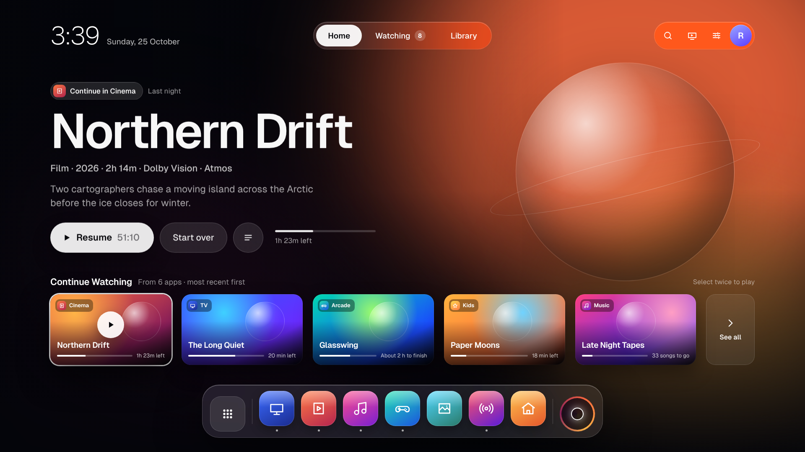
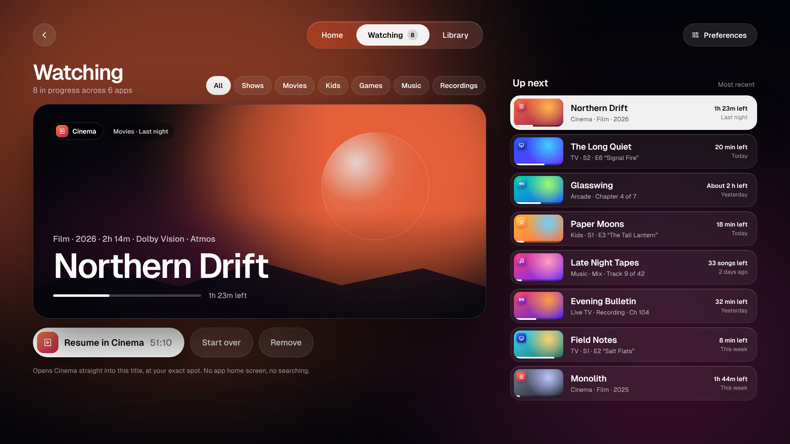
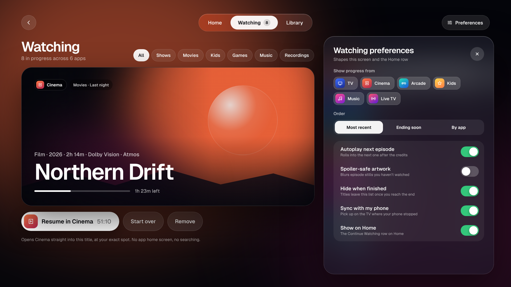
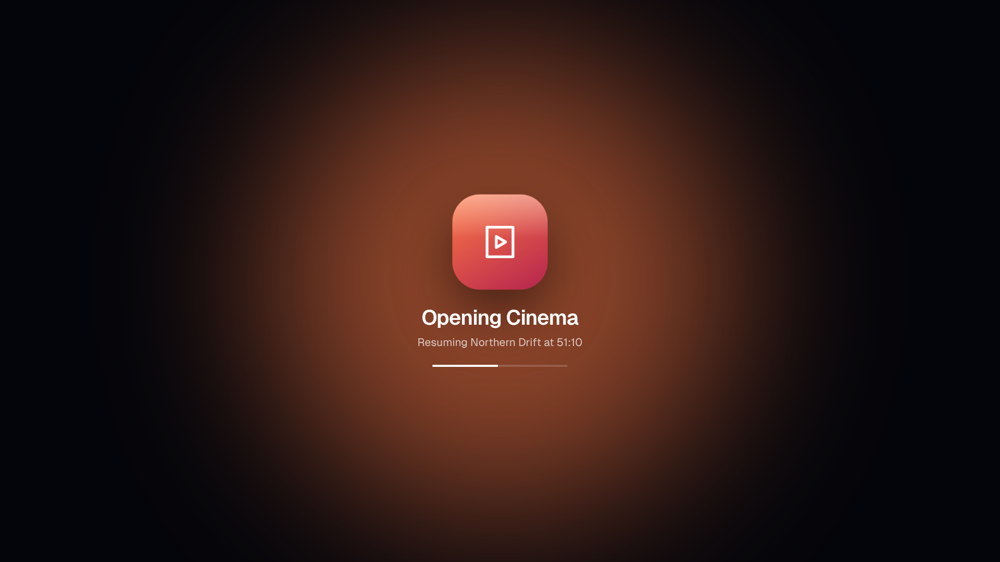
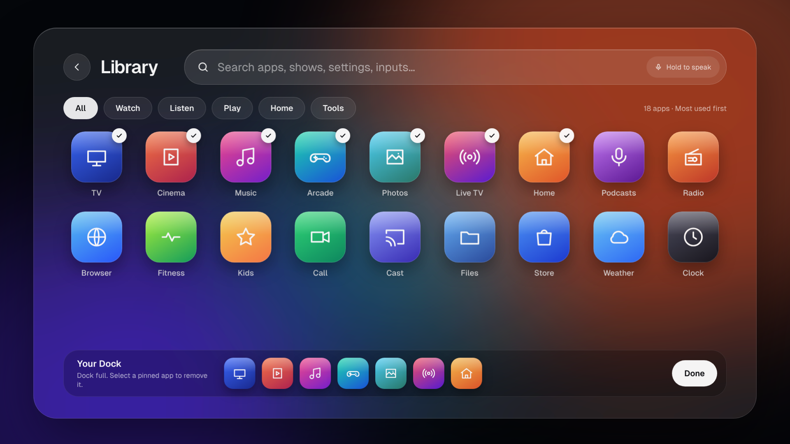
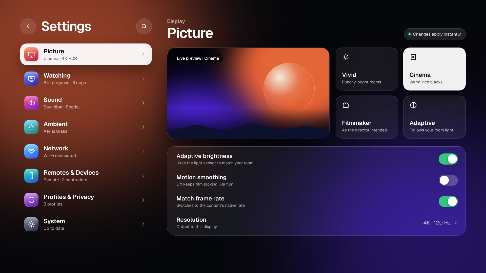
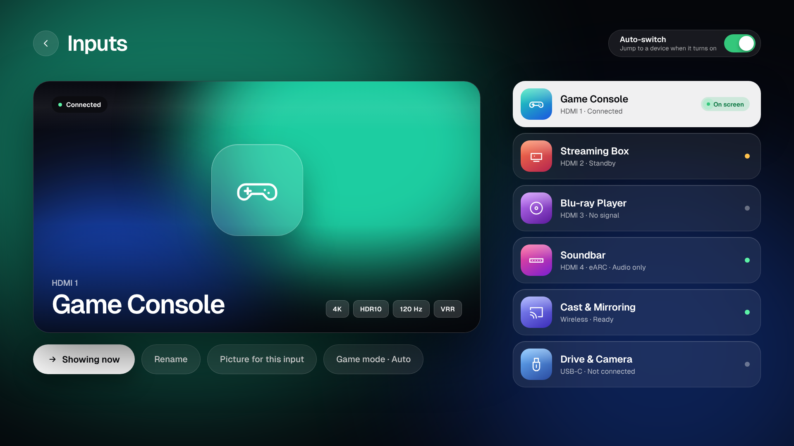
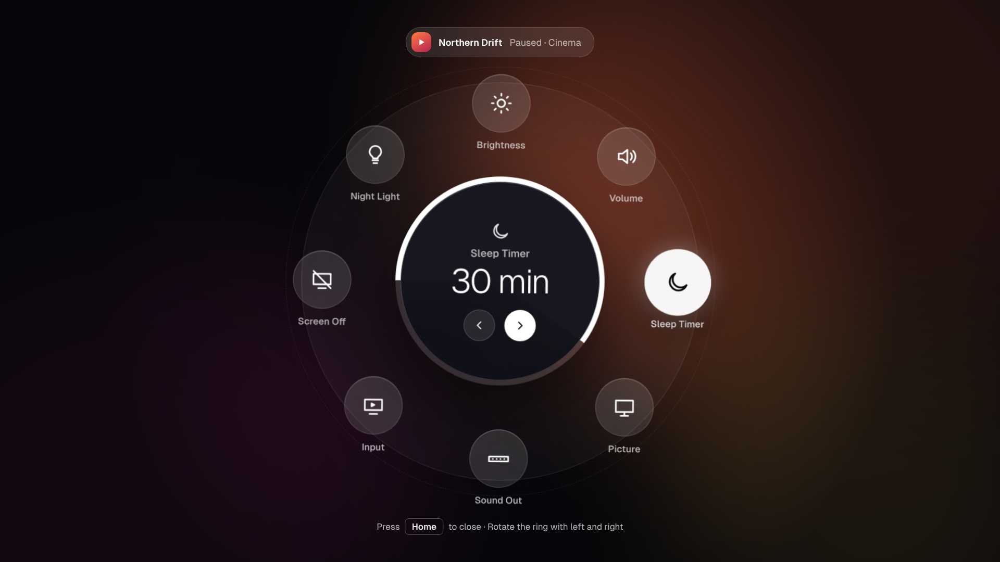

# halo-launcher
Halo — a premium glass-style home screen for Android TV / Google TV. One Continue Watching row across all your apps, resuming each show, film or song at your exact spot where the app allows it. App library with in-app search, Dock, HDMI inputs and a radial quick-control ring.

## Screens

> Design previews — the app on your TV shows your own apps, titles and artwork.

| Home | Watching |
|---|---|
| 

 | 

 |

| Watching preferences | Opening an app |
|---|---|
| 

 | 

 |

| Library & search | Settings |
|---|---|
| 

 | 

 |

| Inputs | Halo quick ring |
|---|---|
| 

 | 

 |
